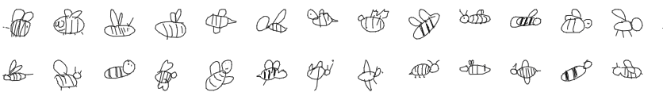
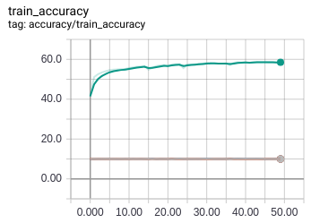
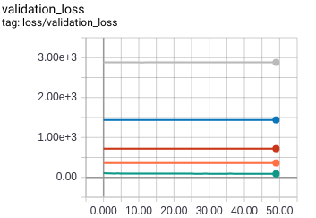
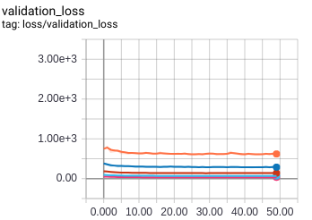
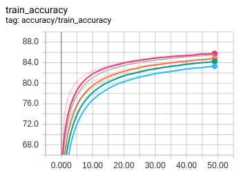
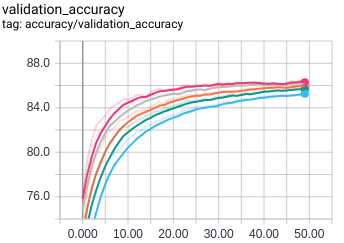
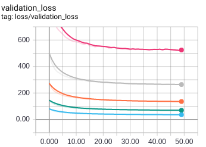

# SketchNet: Hand-Drawn Image Classification

### A Deep Learning Approach to Sketch Recognition Using Convolutional Neural Networks



## 📌 Project Overview

**SketchNet** is a deep learning-based image classification system designed to identify hand-drawn sketches using a custom **Convolutional Neural Network (CNN)**.

The model is trained on a collection of hand-drawn images belonging to 10 different object categories. It learns visual patterns and distinguishing features to classify unseen sketches into their corresponding categories.

The project explores the effectiveness of CNNs for sketch recognition while examining how different learning rates and batch sizes influence model performance.

**Key Highlights:**
- Custom CNN architecture for image classification.
- Classification of sketches across 10 object categories.
- Image preprocessing using Python and NumPy.
- Training, validation, and testing dataset preparation.
- Hyperparameter experimentation with learning rates and batch sizes.
- Performance monitoring using TensorBoard.
- **Best test accuracy: 85.84%.**

---

## 🧠 Dataset Information

SketchNet uses Google's publicly available **Quick, Draw! dataset**, which contains millions of hand-drawn sketches collected through an interactive drawing game.

In the original game, users are given 20 seconds to draw an object while an AI system attempts to recognize it.

For this project, a subset of the dataset was selected to develop and evaluate a custom sketch classification model.

**Dataset Source:** [Google Quick, Draw! Dataset](https://github.com/googlecreativelab/quickdraw-dataset)

### Selected Categories

The model recognizes the following 10 categories:

| Category | Category | Category |
|---|---|---|
| Bear | Bee | Camel |
| Cat | Cow | Crab |
| Crocodile | Dog | Dolphin |
| Duck | | |

### Dataset Distribution

The dataset was divided into three subsets:

| Dataset | Images | Purpose |
|---|---:|---|
| Training | 20,000 | Learning image features |
| Validation | 4,000 | Monitoring model performance |
| Testing | 1,000 | Evaluating generalization |
| **Total** | **25,000** | |

The original images were obtained in **NumPy bitmap (`.npy`) format** and converted into PNG images for model training.

---

## ⚙️ Technologies Used

| Technology | Purpose |
|---|---|
| Python | Model development and data processing |
| NumPy | Handling bitmap image data |
| Convolutional Neural Networks | Extracting image features and classification |
| Deep Learning | Training the classification model |
| Adam Optimizer | Optimizing network parameters |
| TensorBoard | Monitoring training metrics |
| Jupyter Notebook | Visualizing classification results |

---

## 📂 Data Preparation

Before training the model, the dataset must be downloaded and converted into the required image format.

### Step 1: Create a Virtual Environment

```bash
virtualenv venv
```

Activate the environment:

```bash
source venv/bin/activate
```

### Step 2: Install Dependencies

Install the required Python packages:

```bash
pip install -r requirements.txt
```

### Step 3: Download the Dataset

Download the NumPy bitmap files (`.npy`) for the selected categories from the [official dataset repository](https://github.com/googlecreativelab/quickdraw-dataset).

Place the downloaded files inside the `in` directory.

### Step 4: Convert Images

The `convert_to_png.py` script converts the NumPy bitmap data into PNG images and prepares the training, validation, and testing datasets.

Run:

```bash
python convert_to_png.py
```

After preprocessing, the images are ready for model training.

---

## 🚀 Model Training

SketchNet uses a custom **Convolutional Neural Network (CNN)** to recognize patterns in hand-drawn sketches.

The network learns distinguishing visual features from the training data and uses them to predict the category of an unseen sketch.

### Start Training

Execute the training script:

```bash
python training/convolutional.py <batch_size>
```

Replace `<batch_size>` with the desired batch size.

For example:

```bash
python training/convolutional.py 64
```

### Training Configuration

The following parameters were used throughout the experiments:

| Parameter | Value |
|---|---|
| Model | Custom CNN |
| Optimizer | Adam |
| Epochs | 50 |
| Dropout Rate | 0.5 |
| Learning Rates | 0.01, 0.001, 0.0001 |
| Batch Sizes | 32, 64, 128, 256, 512 |
| Classification Categories | 10 |

A total of **15 learning-rate and batch-size combinations** were evaluated across three experimental groups.

---

## 📊 Performance Monitoring

Training progress can be monitored using **TensorBoard**.

The training process stores the accuracy and loss metrics in the `runs` directory.

To launch TensorBoard:

```bash
tensorboard --logdir runs
```

TensorBoard provides visualizations of:

- Training accuracy
- Validation accuracy
- Training loss
- Validation loss

These metrics help analyze convergence, compare experiments, and identify suitable hyperparameters.

---

## 🖼️ Classification Visualization

The project includes a Jupyter Notebook for visualizing the model's classification results.

Open:

```text
ClassificationVisualisation.ipynb
```

The notebook provides a visual representation of the model's predictions on hand-drawn images.


---

# 🔬 Experiments and Results

Three groups of experiments were conducted to analyze the effects of different **learning rates** and **batch sizes** on model performance.

All experiments used the Adam optimizer, 50 training epochs, and a dropout rate of 0.5.

## Experiment 1: Learning Rate = 0.01

The first experiment evaluated the model using a relatively high learning rate.

### Accuracy

| Batch Size | Test Accuracy |
|---|---:|
| 32 | 10.00% |
| 64 | 10.00% |
| 128 | 10.00% |
| 256 | 10.00% |
| **512** | **65.13%** |

### Training and Validation Accuracy




### Training and Validation Loss




### Observations

The learning rate of `0.01` resulted in poor classification performance for most batch sizes.

For batch sizes of 32, 64, 128, and 256, the model achieved only 10% test accuracy.

Since the dataset contains 10 classes, this performance is consistent with the model repeatedly predicting a single category rather than learning meaningful distinguishing features.

Increasing the batch size to 512 improved the test accuracy to **65.13%**.

**Key Finding:** A relatively high learning rate can cause unstable optimization and prevent the model from converging to a useful solution.

---

## Experiment 2: Learning Rate = 0.001

The second experiment reduced the learning rate by a factor of 10 to evaluate whether smaller parameter updates would improve training.

### Accuracy

| Batch Size | Test Accuracy |
|---|---:|
| 32 | 83.82% |
| 64 | 84.91% |
| 128 | 85.78% |
| 256 | 85.58% |
| **512** | **85.84%** |

### Training and Validation Accuracy


### Training and Validation Loss




### Observations

Reducing the learning rate to `0.001` produced a substantial improvement in classification performance.

All batch sizes achieved test accuracies above 83%, demonstrating more effective learning compared with the first experiment.

The highest test accuracy of **85.84%** was achieved using a batch size of 512.

The results suggest that this learning rate provides a more suitable balance between optimization speed and training stability.

**Key Finding:** A learning rate of `0.001` delivered the best classification performance among the tested configurations.

---

## Experiment 3: Learning Rate = 0.0001

The final experiment further reduced the learning rate to investigate the effect of smaller optimization steps.

### Accuracy

| Batch Size | Test Accuracy |
|---|---:|
| 32 | 79.44% |
| **64** | **81.11%** |
| 128 | 79.67% |
| 256 | 80.36% |
| 512 | 79.89% |

### Training and Validation Accuracy





### Training and Validation Loss




### Observations

At a learning rate of `0.0001`, the model demonstrated smoother training curves due to smaller parameter updates.

However, the additional reduction in learning rate did not improve classification accuracy.

The highest test accuracy in this experiment was **81.11%**, achieved using a batch size of 64.

Although smaller learning rates can improve optimization stability, they may also slow convergence within a fixed number of training epochs.

**Key Finding:** A lower learning rate does not necessarily produce better accuracy, particularly when the number of training epochs remains unchanged.

---

## 📈 Comparative Analysis

The following table summarizes the best-performing configuration from each experiment.

| Experiment | Learning Rate | Best Batch Size | Best Test Accuracy |
|---|---|---|---|
| Experiment 1 | 0.01 | 512 | 65.13% |
| **Experiment 2** | **0.001** | **512** | **85.84%** |
| Experiment 3 | 0.0001 | 64 | 81.11% |

### Best Model Configuration

The highest reported test accuracy was obtained with:

| Hyperparameter | Best Configuration |
|---|---|
| Model | Custom CNN |
| Learning Rate | 0.001 |
| Batch Size | 512 |
| Optimizer | Adam |
| Epochs | 50 |
| Dropout | 0.5 |
| **Test Accuracy** | **85.84%** |

---

## 💡 Key Learnings

The experiments highlighted several important aspects of training convolutional neural networks.

**1. Learning Rate Significantly Affects Performance**

The learning rate determines the size of parameter updates during optimization. A large learning rate can cause unstable training, while an excessively small learning rate may slow convergence.

**2. Batch Size Influences Training Behavior**

Different batch sizes produced varying results, demonstrating the importance of selecting an appropriate batch size alongside the learning rate.

**3. Image Preprocessing Is Essential**

Converting NumPy bitmap files into structured PNG datasets enabled the training pipeline to process the images efficiently.

**4. Hyperparameter Tuning Improves Model Performance**

Testing multiple parameter combinations helped identify a configuration that produced better classification results.

**5. Visual Monitoring Helps Understand Model Training**

TensorBoard made it easier to compare accuracy and loss trends across experiments and evaluate model behavior.

---

## ✅ Conclusion

SketchNet demonstrates the application of **Convolutional Neural Networks for hand-drawn image recognition**.

Using a custom CNN trained on 10 sketch categories, the project explored the influence of learning rates and batch sizes on classification accuracy.

Across 15 tested hyperparameter combinations, the best-performing configuration achieved **85.84% test accuracy**, using an Adam optimizer with a learning rate of `0.001` and a batch size of `512`.

The project provides practical experience in image preprocessing, CNN training, hyperparameter tuning, performance evaluation, and deep learning visualization.

---

## 🔗 References

- [Google Quick, Draw! Dataset](https://github.com/googlecreativelab/quickdraw-dataset)
- [TensorBoard Documentation](https://www.tensorflow.org/tensorboard)

---

**Project:** SketchNet — Hand-Drawn Image Classification  
**Domain:** Deep Learning | Computer Vision | Image Classification
