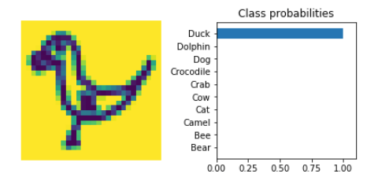
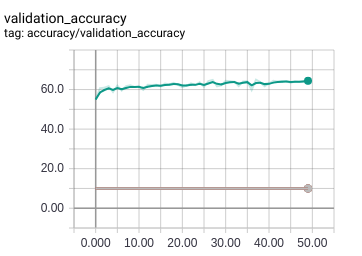
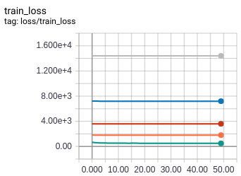
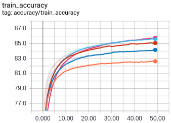
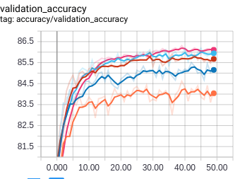
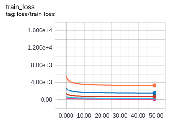
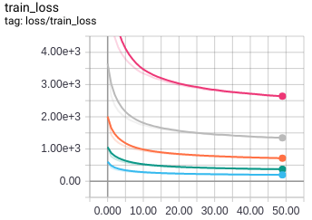

# SketchNet: Hand-Drawn Image Classification


## Overview

SketchNet is a deep learning-based image classification system that uses a custom Convolutional Neural Network (CNN) to recognize hand-drawn sketches.

The model is trained using Google's Quick, Draw! dataset and classifies sketches into 10 different object categories.

The project focuses on image preprocessing, CNN training, hyperparameter optimization, and evaluating how learning rates and batch sizes affect classification performance.

### Key Features

- Custom CNN for hand-drawn image classification
- Recognition of 10 different object categories
- Image preprocessing using Python and NumPy
- Automated conversion of `.npy` files into PNG images
- Hyperparameter tuning across 15 configurations
- Training visualization using TensorBoard
- **Best test accuracy: 86.11%**

---

## Dataset

SketchNet uses the publicly available Google Quick, Draw! dataset.

Quick, Draw! is an AI-powered drawing game developed by Google. Players are given 20 seconds to draw an object while a neural network attempts to identify it.

The dataset contains a large collection of human-drawn sketches that can be used to train machine learning models for image recognition.

**Dataset Source:** [Google Quick, Draw! Dataset](https://github.com/googlecreativelab/quickdraw-dataset)

### Selected Classes

The model recognizes the following 10 categories:

1. Bear
2. Bee
3. Camel
4. Cat
5. Cow
6. Crab
7. Crocodile
8. Dog
9. Dolphin
10. Duck

### Dataset Distribution

| Dataset | Number of Images |
|---------|-----------------:|
| Training | 20,000 |
| Validation | 4,000 |
| Testing | 1,000 |
| **Total** | **25,000** |

The original dataset is provided in NumPy bitmap (`.npy`) format. These files are converted into PNG images before model training.

---

## Technologies Used

| Technology | Application |
|------------|-------------|
| Python | Data processing and model development |
| NumPy | Handling bitmap image data |
| CNN | Image feature extraction and classification |
| Deep Learning | Training the classification model |
| Adam Optimizer | Model parameter optimization |
| TensorBoard | Training performance visualization |
| Jupyter Notebook | Classification result visualization |

---

## Installation and Setup

### 1. Create a Virtual Environment

```bash
virtualenv venv
```

Activate the environment:

```bash
source venv/bin/activate
```

### 2. Install Dependencies

```bash
pip install -r requirements.txt
```

### 3. Prepare the Dataset

Download the NumPy bitmap files (`.npy`) for the selected categories from the official dataset repository.

Place the downloaded files inside the `in` directory.

The `convert_to_png.py` script processes the NumPy bitmap files and converts them into PNG images.

Run:

```bash
python convert_to_png.py
```

The generated images are organized into training, validation, and testing datasets.

---

## Model Training

SketchNet uses a custom Convolutional Neural Network to learn visual patterns from hand-drawn sketches.

To begin training, execute:

```bash
python training/convolutional.py <batch_size>
```

For example:

```bash
python training/convolutional.py 64
```

### Training Parameters

| Parameter | Value |
|-----------|-------|
| Model | Custom CNN |
| Optimizer | Adam |
| Epochs | 50 |
| Dropout | 0.5 |
| Learning Rates | 0.01, 0.001, 0.0001 |
| Batch Sizes | 32, 64, 128, 256, 512 |
| Number of Classes | 10 |

A total of 15 hyperparameter combinations were evaluated across three experiments.

---

## Performance Visualization

TensorBoard is used to monitor the training process and compare experimental results.

Training logs are stored in the `runs` directory.

Launch TensorBoard using:

```bash
tensorboard --logdir runs
```

TensorBoard provides visualizations of:

- Training accuracy
- Validation accuracy
- Training loss
- Validation loss

### Classification Visualization

The project also includes a Jupyter Notebook:

`ClassificationVisualisation.ipynb`

This notebook provides visualizations of the model's classification results.



---

# Experiments and Results

Three experiments were conducted to analyze the impact of learning rates and batch sizes on CNN performance.

All experiments used:

- **Optimizer:** Adam
- **Epochs:** 50
- **Dropout:** 0.5
- **Batch Sizes:** 32, 64, 128, 256, 512

## Experiment 1: Learning Rate = 0.01

The first experiment evaluated model performance using a relatively high learning rate.

### Test Accuracy

| Batch Size | Accuracy | Plot Color |
|------------|---------:|------------|
| 32 | 10.00% | Grey |
| 64 | 10.00% | Blue |
| 128 | 10.00% | Red |
| 256 | 10.00% | Orange |
| **512** | **65.13%** | **Green** |

### Training and Validation Accuracy




### Training and Validation Loss




### Observations

The learning rate of `0.01` resulted in poor performance for most batch sizes.

Models trained with batch sizes of 32, 64, 128, and 256 achieved only 10% test accuracy, consistent with repeatedly predicting a single class in a balanced 10-class classification problem.

Increasing the batch size to 512 improved accuracy to 65.13%.

**Conclusion:** A high learning rate can cause unstable optimization and prevent the model from learning useful image features.

---

## Experiment 2: Learning Rate = 0.001

The second experiment reduced the learning rate by a factor of 10 to examine its effect on classification accuracy.

### Test Accuracy

| Batch Size | Accuracy | Plot Color |
|------------|---------:|------------|
| 32 | 83.82% | Orange |
| 64 | 84.91% | Blue |
| 128 | 85.78% | Red |
| 256 | 85.58% | Light Blue |
| **512** | **85.84%** | **Magenta** |

### Training and Validation Accuracy





### Training and Validation Loss




### Observations

Reducing the learning rate to `0.001` significantly improved model performance.

All tested batch sizes achieved more than 83% accuracy.

The best result in this experiment was **85.84%**, obtained with a batch size of 512.

**Conclusion:** A smaller learning rate improved the training process and resulted in substantially better classification accuracy.

---

## Experiment 3: Learning Rate = 0.0001

The third experiment evaluated the effect of reducing the learning rate further to `0.0001`.

### Test Accuracy

| Batch Size | Accuracy | Plot Color |
|------------|---------:|------------|
| 32 | 85.77% | Magenta |
| **64** | **86.11%** | **Grey** |
| 128 | 85.54% | Orange |
| 256 | 85.34% | Green |
| 512 | 84.57% | Light Blue |

### Training and Validation Accuracy


### Training and Validation Loss




### Observations

Reducing the learning rate to `0.0001` resulted in smoother training curves because the optimizer made smaller parameter updates.

The model achieved consistently high test accuracy across all tested batch sizes.

The highest accuracy was **86.11%**, obtained using a batch size of 64.

This configuration also produced the best test accuracy across all three experiments.

**Conclusion:** The lower learning rate provided stable training and achieved the highest classification accuracy, although improvements over the second experiment were relatively small.

---

## Comparative Performance Analysis

The following table summarizes the best-performing configuration from each experiment.

| Experiment | Learning Rate | Best Batch Size | Test Accuracy |
|------------|---------------|-----------------|---------------|
| Experiment 1 | 0.01 | 512 | 65.13% |
| Experiment 2 | 0.001 | 512 | 85.84% |
| **Experiment 3** | **0.0001** | **64** | **86.11%** |

### Best Model Configuration

| Parameter | Value |
|-----------|-------|
| Architecture | Custom CNN |
| Optimizer | Adam |
| Learning Rate | 0.0001 |
| Batch Size | 64 |
| Epochs | 50 |
| Dropout | 0.5 |
| Classes | 10 |
| **Best Test Accuracy** | **86.11%** |

---

## Key Learnings

### 1. Learning Rate Optimization

Learning rate selection had a significant impact on model performance.

A high learning rate resulted in poor convergence, while smaller learning rates provided better classification accuracy.

### 2. Batch Size Selection

Batch size influenced the model's performance across different learning rates.

The best-performing batch size varied between experiments, highlighting the importance of tuning both parameters together.

### 3. Image Preprocessing

Converting NumPy bitmap files into PNG format and organizing the dataset helped establish a structured training pipeline.

### 4. Hyperparameter Experimentation

Testing 15 different combinations helped identify the model configuration that achieved the highest reported accuracy.

### 5. Performance Monitoring

TensorBoard enabled visualization of training and validation metrics, making it easier to compare model behavior across experiments.

---

## Conclusion

SketchNet demonstrates the application of Convolutional Neural Networks to hand-drawn image classification.

The project involved processing sketch data, training a custom CNN, and evaluating multiple learning rates and batch sizes.

Across 15 experimental configurations, the best-performing model achieved **86.11% test accuracy** using:

- Learning rate: `0.0001`
- Batch size: `64`
- Adam optimizer
- 50 epochs
- Dropout rate: `0.5`

These results highlight the importance of data preprocessing, hyperparameter tuning, and systematic performance evaluation when developing deep learning models.

---

## References

- [Google Quick, Draw! Dataset](https://github.com/googlecreativelab/quickdraw-dataset)
- [TensorBoard Documentation](https://www.tensorflow.org/tensorboard)

---

**SketchNet — Hand-Drawn Image Classification using Deep Learning**
